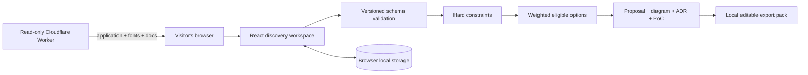

# Architecture, decision records and runbook

## Customer problem

Technical discovery often produces a list of technologies before requirements and ownership are clear. A proposal then hides the assumptions behind its recommendation or offers a cost total that cannot be reconciled. This workbench connects the structured brief to an explicit comparison and preserves the evidence when a new constraint changes the direction.

## Architecture

`src/model.ts` owns the schema, arithmetic, gates and scoring. `fixtures.ts` owns the three fictional workshops. `proposal.ts` creates proposed sections, the conceptual SVG, decision record and PoC plan. `files.ts` creates the ZIP and browser download. `storage.ts` validates saved drafts and preserves unreadable data for recovery. The UI does not send draft contents to the Worker.

## Decision record 001: Browser-local drafts

Status: Accepted for version 1. A public portfolio demonstrator needs no visitor account or shared customer records. Local persistence and explicit import/export allow a complete workshop without a backend data store. This avoids publicly storing user-entered discovery data. The trade-off is one active draft per browser origin, no collaboration and no automatic cross-device recovery. Export before switching scenarios or clearing browser data.

The rejected alternative is a shared cloud draft store with login. It would add identity, retention, tenant isolation and operational responsibilities without being required by this release's workflow. A future collaboration feature would need an explicit design and access model.

## Decision record 002: Explicit model before AI drafting

Status: Accepted for version 1. Hard constraints and reproducible arithmetic make the recommendation explainable. The rule catalogue, weights, cost rates and calculations are visible. Authored wording is separate from the generated decision. There is no AI dependency or undisclosed generation step.

The trade-off is deliberately limited coverage. These three blueprints cannot represent every integration architecture. Unstructured notes do not silently become model inputs. An additional drafting layer could be considered after preserving the current deterministic decision and provenance boundaries.

## Decision record 003: Gates, grades and conditional fit

Status: Accepted for version 1. A blocked option cannot win by scoring well elsewhere. The model checks private processing, pinned-region support, intermittent connectivity, latency, staffing, lead time and recurring cost cap. Required but unspecified location creates an open condition. Unreviewed costs also create a condition.

Among eligible options, fit ranks ahead of conditional fit, followed by descending weighted score, ascending recurring cost and fixed catalogue order. If all options are blocked, the proposal describes discovery work to resolve the conflict and omits an implementation commitment.

Baseline ratings are: workflow 5/5 speed, 5/5 operations, 2/5 flexibility, 3/5 recovery; events 3/5, 3/5, 5/5, 5/5; private service 2/5, 1/5, 4/5, 4/5. These are declared planning judgements about the scoped designs, not market benchmarks. The cost grade uses all three catalogue costs, including blocked options, so hard-gate changes do not silently alter other grades.

Minimum delivery-latency assumptions are 60, 1 and 2 seconds. Lead-time allowances are 4, 7 and 11 weeks, adding one week for each two systems beyond three, rounded up. They are PoC hypotheses and planning allowances. Selecting a vendor would require checking actual connectors, supported locations, retry semantics, limits, operating model and rates.

## Arithmetic and import boundaries

Planned load is `ceil(current × (1 + growth/100) × (1 + headroom/100))`. Monthly events and peak events/minute are independent inputs. Percentage inputs use at most two decimal places; integer BigInt ratios avoid accidental upward rounding from binary fractions. Cost inputs also have at most two decimals. Fixed, traffic and operating cost lines are rounded to cents before summing. Implementation hours times labour rate and one-off migration costs make the setup total. Year one equals twelve monthly totals plus setup.

Traffic is billed pro-rata in this model; no vendor billing tier is implied. Labour estimates are allocated effort, not a promise of elapsed delivery time. The monthly cap excludes setup. Currency relabels amounts and never performs foreign-exchange conversion. No tax, discount, inflation, financing, profit or ROI assumptions are added.

Imports are strict version-1 JSON with supported fields, typed values, bounded text, up to twelve distinct system names, finite numbers and a 128 KiB limit. Complete pretty-printed exports must fit that same byte limit. Unknown fields and prototype-shaped objects are rejected. Invalid data never replaces the active draft. Invalid current form input does not overwrite the last valid saved copy.

SVG text is XML-escaped, Markdown text escapes raw HTML, and CSV cells are quoted with leading formula characters neutralised. ZIP paths are fixed names rather than user-controlled paths. The app renders author text through React text or textareas, with no HTML execution or Markdown renderer.

## Review provenance

Every structured change increments the brief revision and clears cost review. A pinned baseline freezes the previous structured inputs. Author-edited sections record the revision they were based on. Later changes preserve the text and flag it as stale. The user can edit it again, explicitly mark it reviewed or return to current generated wording. Exports retain both the edited text and its revision flag. User review is not customer sign-off or vendor verification.

## Build and hosting

The Worker receives no customer-state bindings. `.openai/hosting.json` keeps D1 and R2 unused. `npm run build` compiles to ignored `.runtime/client`, embeds files in `dist/server/index.js` and copies the source hosting manifest. The archive contains no separate client directory, keeping all responses behind the Worker's CSP, no-frame, no-referrer and MIME headers. Hashed assets are immutable; documents and HTML revalidate; health responses are no-store.

The health response exposes a SHA-256 fingerprint of the declared application sources. Public smoke checks compare it to the local sources, along with real HTTPS, static assets, local fonts, documents, route boundaries and security headers. POST requests are rejected; there is no server draft API.

## Operator runbook

| Symptom | Action |
| --- | --- |
| All options blocked | Inspect each hard-gate reason; reconcile staffing, boundary, deadline or cost assumptions |
| An option is conditional | Review cost assumptions and outstanding location/processor conditions |
| Export disabled | Correct invalid discovery, cost or weight inputs |
| Edited section flagged stale | Compare it to current facts, revise it or explicitly mark user review |
| Saved data cannot be read | Download the preserved recovery data; start from a valid scenario or import a valid brief |
| Storage unavailable/full | The page remains usable in memory; export before closing |
| Import rejected | Check schema, types, field bounds and the 128 KiB file limit; current data is preserved |
| Unexpected public version | Compare `/api/health` to the recorded source fingerprint and deployment version |

Run the README checks before publication. Push exact source, package it with the Sites source helper, save a Site version and deploy it. A new Site may require one initial publication before its public access setting is provisioned; apply the user-requested public audience afterwards and verify it. Set the custom domain using only the hosting service's issued DNS records. Roll back by redeploying a previously validated Site version; browser drafts remain local and imports stay versioned.

## Method references

The proposed ADR uses context, decision and consequences, following [AWS Prescriptive Guidance](https://docs.aws.amazon.com/prescriptive-guidance/latest/architectural-decision-records/adr-process.html). The event blueprint includes durable recovery, contract and operating considerations informed by [Microsoft's event-driven architecture guidance](https://learn.microsoft.com/en-us/azure/architecture/guide/architecture-styles/event-driven). The ratings, timing assumptions and sample costs are this project's own fictional fixtures, not claims from those references.
